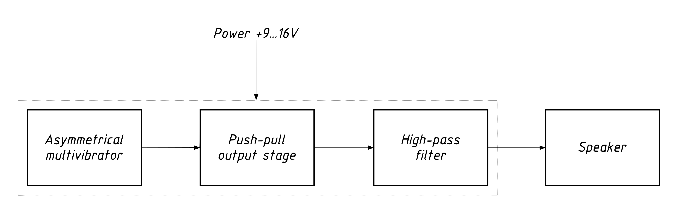
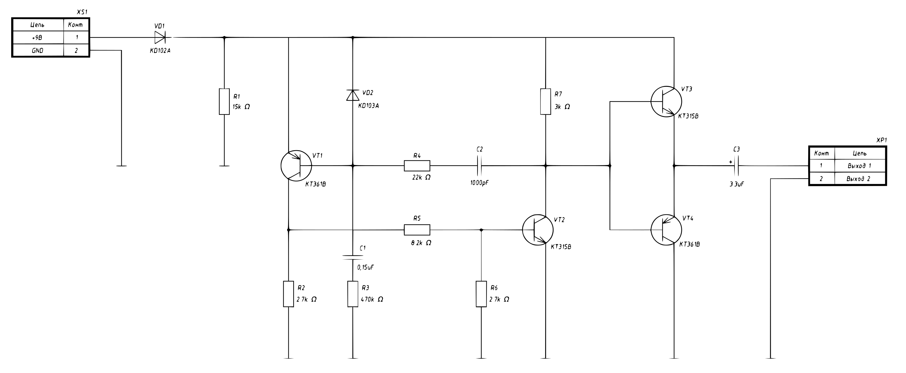
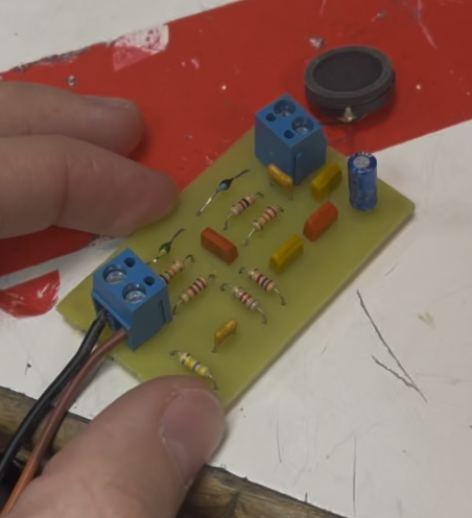

# Audible Turn Signal Indicator

A compact, discrete-transistor audible indicator for a vehicle turn-signal circuit. The multivibrator generates the audio tone, while the vehicle flasher supplies the on/off rhythm. A push-pull transistor stage drives an external loudspeaker.

| Specification | Value |
|---|---|
| Supply voltage | 9–16 V DC (per project documentation) |
| PCB dimensions | 60 × 35 mm |
| PCB construction | Single-sided, through-hole assembly |
| Overall assembled dimensions | 60 × 35 × 16 mm |
| Sound output | External loudspeaker |

## Block Diagram

Power enters through the input connector and reverse-polarity protection diode VD1. Transistors VT1 and VT2 form an asymmetric multivibrator. Its timing networks generate the tone. Transistors VT3 and VT4 form a push-pull output stage that drives the external loudspeaker through coupling capacitor C3. When the vehicle flasher interrupts the supply, the tone follows its flashing rhythm.

## Schematic

The circuit is built from discrete components. VD1 protects the input from reversed polarity. VT1 and VT2 generate oscillation, with C1/R3 and C2/R4 setting the timing. The oscillator output controls the complementary transistor output stage. Connector XP1 connects the loudspeaker.

## PCB Design

The board measures 60 × 35 mm and has one copper layer. Components are mounted on one side. The board layout drawing specifies 0.45 mm minimum track width and clearance, and a 1.2 mm minimum nominal hole diameter.

Editable Altium Designer project files are in [`hardware/altium/`](hardware/altium/). Manufacturing exports are provided as [Gerber files](fabrication/turn-signal-indicator_gerber.zip) and a [STEP 3D model](fabrication/turn-signal-indicator.step).

## Built Device

The assembled through-hole prototype connects to the vehicle signal supply at XS1 and drives an external speaker from XP1. The audible tone is present while the turn-signal supply is active.

## Bill of Materials

| Designator | Description | Value | Quantity | Manufacturer | Part Number | Package |
|---|---|---|---:|---|---|---|
| R1 | Carbon film resistor ±5%, 0.25 W | 15 kΩ | 1 | Yageo | CF-1/4W-15KJ | CF-25 |
| R2, R6 | Carbon film resistor ±5%, 0.25 W | 2.7 kΩ | 2 | Yageo | CF-1/4W-2K7J | CF-25 |
| R3 | Carbon film resistor ±5%, 0.25 W | 470 kΩ | 1 | Yageo | CF-1/4W-470KJ | CF-25 |
| R4 | Carbon film resistor ±5%, 0.25 W | 22 kΩ | 1 | Yageo | CF-1/4W-22KJ | CF-25 |
| R5 | Carbon film resistor ±5%, 0.25 W | 8.2 kΩ | 1 | Yageo | CF-1/4W-8K2J | CF-25 |
| R7 | Carbon film resistor ±5%, 0.25 W | 3 kΩ | 1 | Yageo | CF-1/4W-3KJ | CF-25 |
| XP1 | 2-pin connector (plug) | KLS 2Pin 5.0mm | 1 | KLS electronic Co Ltd | L-KLS2-300-5.00-02P-2S | THT |
| XS1 | 2-pin connector (socket) | KLS 2Pin 5.0mm | 1 | KLS electronic Co Ltd | L-KLS2-300-5.00-02P-2S | THT |
| C1 | Non-polarized capacitor 40V 20% | 0.15 µF | 1 | JB Capacitors | JYM1H154KBX010000B | MLCC |
| C2 | Non-polarized capacitor 160V 10% | 1000 pF | 1 | JB Capacitors | JYM1H102JBN010000B | MLCC |
| C3 | Polarized capacitor 50V 20% | 3.3 µF | 1 | JB Capacitors | JRB1H3R3M02000500110000B | ECAP |
| VD1 | Silicon Diode | KD102A | 1 | GOST | KD102A | KD-30 |
| VD2 | Silicon Diode | KD103A | 1 | GOST | KD103A | KD-30 |
| VT1, VT4 | PNP bipolar junction transistor | KT361B | 2 | GOST | KT361B | KT-13 |
| VT2, VT3 | NPN bipolar junction transistor | KT315B | 2 | GOST | KT315B | KT-13 |

## Documentation in Russian

- [E1 block diagram](docs/original-ru/turn-signal-indicator_E1_block-diagram.PDF)
- [E3 circuit schematic](docs/original-ru/turn-signal-indicator_E3_schematic.PDF)
- [PE3 parts list](docs/original-ru/turn-signal-indicator_PE3_parts-list.pdf)
- [PCB drawing](docs/original-ru/turn-signal-indicator_PP_board-drawing.PDF)
- [Assembly drawing](docs/original-ru/turn-signal-indicator_SB_assembly-drawing.pdf)
- [Specification](docs/original-ru/turn-signal-indicator_SP_specifictaion.PDF)
- [CSV bill of materials](docs/turn-signal-indicator.csv)

## Additional Notes

This repository contains hardware design and documentation. It does not include firmware or software.
