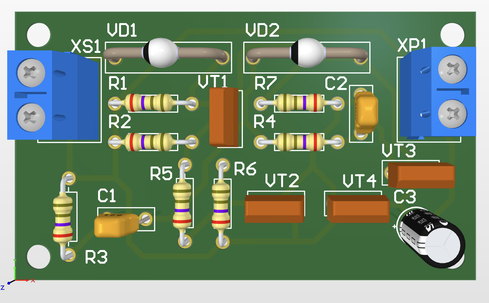
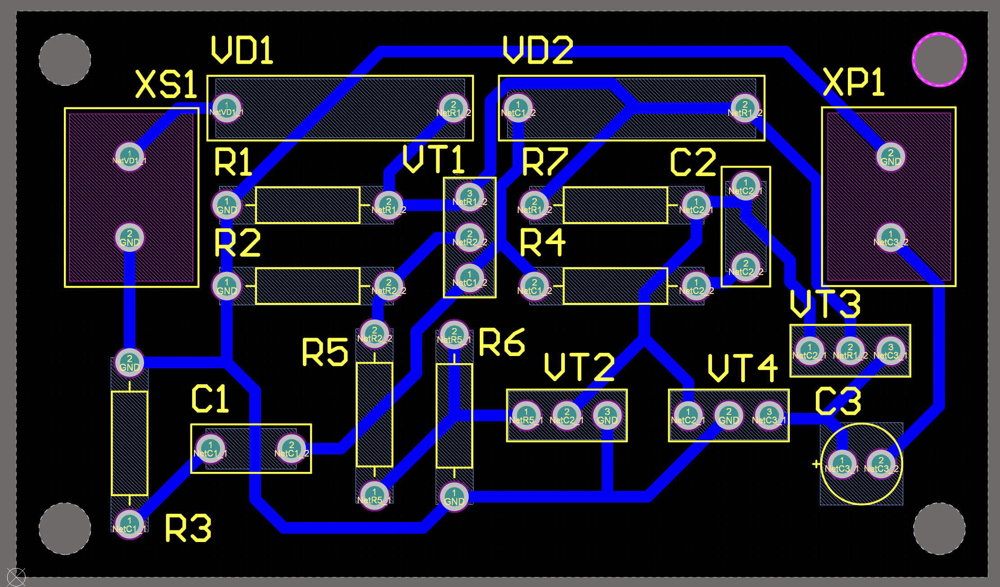

# Audible Turn Signal Indicator

A single-layer **60 × 35 mm** through-hole PCB designed in Altium Designer as an academic
hardware project. The circuit uses a discrete-transistor oscillator and output stage to
produce an audible indication through an external speaker when supplied with **9–16 V DC**.

The repository contains editable Altium sources, PCB views, manufacturing outputs, and the
original Russian engineering drawings prepared in the ESKD format. Assembly and electrical
validation are not documented here.

## Block diagram

- **Power input.** XS1 supplies the circuit from a 9–16 V DC source; VD1 is in series with the
  positive input.
- **Oscillator.** An asymmetric astable multivibrator generates the drive signal.
- **Output stage.** A push-pull transistor stage drives the output network.
- **Output network.** The structural diagram specifies a high-frequency filter before the
  external speaker, connected via XP1.

The original [structural diagram (E1)](docs/original-ru/turn-signal-indicator_E1_block-diagram.PDF)
is available in Russian.

## Schematic (E3)

Click the schematic preview to open the full-size original PDF drawing.

The circuit uses four bipolar transistors (VT1–VT4), two diodes (VD1–VD2), seven resistors,
and three capacitors. It is implemented entirely with discrete components, without a
microcontroller.

- [Circuit schematic (E3, PDF)](docs/original-ru/turn-signal-indicator_E3_schematic.PDF)
- [Editable schematic (Altium SchDoc)](hardware/altium/turn-signal-indicator_E3_schematic.SchDoc)

## PCB

Single-layer, **60 × 35 mm** PCB with through-hole components and four mounting holes.
The board layout and mechanical details are available in the
[PCB fabrication drawing](docs/original-ru/turn-signal-indicator_PP_board-drawing.PDF).

## Connectors

| Connector | Pin 1 | Pin 2 |
| --- | --- | --- |
| XS1 — DC input | +9–16 V | GND |
| XP1 — speaker output | Output 1 | Output 2 |

The speaker is external to the PCB and connects across XP1 pins 1 and 2.

## Bill of materials (based on the original PE3)

### Capacitors

| Ref | Qty | Original PE3 entry |
| --- | ---: | --- |
| C1 | 1 | К10-17Б 0,15 мкФ 40В 20% (ЮЖО.460.172 ТУ) |
| C2 | 1 | КМ5Б 1000пФ 160В 10% (ЮЖО.460.161 ТУ) |
| C3 | 1 | JRB1H3R3M02000500110000B (JB Capacitors, Тайвань) |

### Resistors

| Ref | Qty | Original PE3 entry |
| --- | ---: | --- |
| R1 | 1 | CF-25 15кОм 0,25Вт 5% (Yageo, Тайвань) |
| R2, R6 | 2 | CF-25 2,7кОм 0,25Вт 5% (Yageo, Тайвань) |
| R3 | 1 | CF-25 470кОм 0,25Вт 5% (Yageo, Тайвань) |
| R4 | 1 | CF-25 22кОм 0,25Вт 5% (Yageo, Тайвань) |
| R5 | 1 | CF-25 8,2кОм 0,25Вт 5% (Yageo, Тайвань) |
| R7 | 1 | CF-25 3кОм 0,25Вт 5% (Yageo, Тайвань) |

### Diodes

| Ref | Qty | Original PE3 entry |
| --- | ---: | --- |
| VD1 | 1 | КД102А (ГГ3.362.083 ТУ) |
| VD2 | 1 | КД103А (ГГ3.362.082 ТУ) |

### Transistors

| Ref | Qty | Original PE3 entry |
| --- | ---: | --- |
| VT1, VT4 | 2 | КТ361Б (ФЫЮ.336.201 ТУ) |
| VT2, VT3 | 2 | КТ315Б (ИЖК3.365.200 ТУ) |

### Connectors

| Ref | Qty | Original PE3 entry |
| --- | ---: | --- |
| XS1, XS2 | 2 | KLS2-300-5.00-02P-2S (KLS electronic co ltd, Китай) |

**Note.** The original PE3 uses connector designators **XS1** and **XS2**, while the updated
Altium project uses **XS1** and **XP1**. This README preserves the original PE3 wording in the BOM,
but the active design files use XP1 for the speaker output connector.

See the [full BOM (CSV)](docs/turn-signal-indicator.csv) and the
[original parts list (PE3, PDF)](docs/original-ru/turn-signal-indicator_PE3_parts-list.pdf).

## Engineering documentation

The following original drawings are in Russian and follow the ESKD documentation format:

| Document | Description |
| --- | --- |
| [E1](docs/original-ru/turn-signal-indicator_E1_block-diagram.PDF) | Structural diagram |
| [E3](docs/original-ru/turn-signal-indicator_E3_schematic.PDF) | Circuit schematic |
| [PP](docs/original-ru/turn-signal-indicator_PP_board-drawing.PDF) | PCB fabrication drawing |
| [SB](docs/original-ru/turn-signal-indicator_SB_assembly-drawing.pdf) | Assembly drawing |
| [PE3](docs/original-ru/turn-signal-indicator_PE3_parts-list.pdf) | Parts list |
| [Specification](docs/original-ru/turn-signal-indicator_SP_specifictaion.pdf) | Assembly specification |

## Project files

- [Altium project](hardware/altium/turn-signal-indicator.PrjPcb) and associated schematic,
  PCB, library, BOM, and output-job files in [`hardware/altium/`](hardware/altium/).
- [Gerber archive](fabrication/turn-signal-indicator_gerber.zip) and
  [STEP model](fabrication/turn-signal-indicator.step).

The Gerber files are design outputs; their presence does not imply manufacturing or
functional validation.
